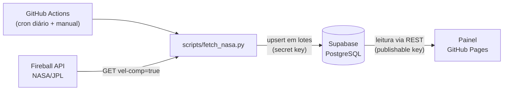

# SSD-CNEOS-Fireball: bólidos registrados pela NASA/JPL

Projeto acadêmico do **Grupo 07**: um pipeline coleta todo dia os dados da API **SSD/CNEOS Fireball** (NASA/JPL), grava em um banco PostgreSQL no **Supabase** e publica um painel interativo no **GitHub Pages**.

- **Painel:** https://sn-2026-grupo-07-nasa.github.io/SSD-CNEOS-Fireball/
- **Repositório:** https://github.com/SN-2026-GRUPO-07-NASA/SSD-CNEOS-Fireball

---

## O que é um bólido

Um **bólido** (em inglês, *fireball*) é um meteoro excepcionalmente brilhante. É um fragmento de asteroide que entra na atmosfera da Terra e se desintegra, liberando muita energia, às vezes equivalente a quilotons de TNT. Sensores do governo dos EUA detectam esses clarões, e o **CNEOS** (Center for Near Earth Object Studies, do JPL/NASA) publica os eventos.

## A API SSD/CNEOS Fireball

- **Endereço:** `https://ssd-api.jpl.nasa.gov/fireball.api` ([documentação](https://ssd-api.jpl.nasa.gov/doc/fireball.html))
- **Autenticação:** nenhuma; a API é pública e não precisa de chave.
- **Formato:** JSON com `fields` (nomes das colunas) e `data` (linhas, com todos os valores em texto).
- **Parâmetro usado:** `vel-comp=true`, que inclui as componentes da velocidade (`vx`, `vy`, `vz`).

### Campos principais e unidades

| Campo da API | Significado | Unidade | Coluna no banco |
|---|---|---|---|
| `date` | Data/hora do pico de brilho | UTC (`YYYY-MM-DD hh:mm:ss`) | `data_hora_utc` |
| `energy` | Energia total irradiada | 10¹⁰ joules | `energia_irradiada_j_e10` |
| `impact-e` | Energia de impacto estimada | quilotons de TNT (kt) | `energia_impacto_kt` |
| `lat` + `lat-dir` | Latitude e hemisfério (`N`/`S`) | graus | `latitude_graus` (Sul negativo) |
| `lon` + `lon-dir` | Longitude e direção (`E`/`W`) | graus | `longitude_graus` (Oeste negativo) |
| `alt` | Altitude do pico de brilho | km | `altitude_km` |
| `vel` | Velocidade antes do impacto | km/s | `velocidade_km_s` |
| `vx`, `vy`, `vz` | Componentes da velocidade (geocêntrica) | km/s | `velocidade_x_km_s`, `velocidade_y_km_s`, `velocidade_z_km_s` |

Localização, altitude e velocidade podem vir nulas, porque nem todo evento tem essas medições. Energia e data sempre vêm preenchidas.

---

## Arquitetura



Na forma de texto:

```
GitHub Actions ──▶ fetch_nasa.py ──▶ Supabase (PostgreSQL) ──▶ GitHub Pages
 (06:17 UTC)        │   ▲              bolidos / execucoes        painel/
                    │   └── Fireball API (NASA/JPL)
                    └── grava com a secret key; o painel só lê com a publishable key
```

### Etapas

1. **Agendamento** (`.github/workflows/update-data.yml`)
   - Roda todo dia às **06:17 UTC** (03:17 em Brasília) e também manualmente (`workflow_dispatch`).
   - Tem `permissions: contents: read` (menor privilégio), `concurrency` para impedir duas execuções simultâneas e `timeout-minutes: 15`.
   - Usa Python 3.12, instala o `requirements.txt` (`requests`) e roda o script com os secrets do repositório.

2. **Coleta e gravação** (`scripts/fetch_nasa.py`)
   - **Coleta:** faz um GET na Fireball API, com timeout (10 s para conectar e 30 s para ler) e até 3 tentativas com espera exponencial (2 s, 4 s) em erros de rede, HTTP 429 e 5xx.
   - **Validação:** confere se a resposta tem `fields`, `data` e todos os campos esperados.
   - **Normalização:**
     - converte a data para ISO 8601 em UTC;
     - converte texto em número, rejeitando `nan` e `inf`;
     - aplica sinal à latitude e à longitude conforme a direção;
     - valida as mesmas faixas das `CHECK` do banco.
     - Linhas inválidas são descartadas e contadas.
   - **Deduplicação:** mantém um único registro por `data_hora_utc` na lista inteira.
   - **Upsert:** envia os registros em lotes de 500 para o PostgREST, com `on_conflict=data_hora_utc` e `Prefer: resolution=merge-duplicates`. A falha de um lote não interrompe os outros.
   - **Registro:** sempre grava uma linha em `execucoes`, inclusive quando há erro.
   - **Modo `--dry-run`:** coleta e normaliza, mas não acessa o Supabase.

3. **Armazenamento:** o Supabase guarda tudo em PostgreSQL. A estrutura é criada por `sql/setup.sql`.

4. **Painel** (`painel/`, publicado no GitHub Pages)
   - `index.html`, `style.css` e `script.js` leem o banco pela API REST do Supabase.
   - Carregam todos os registros com paginação (`limit`/`offset`, em blocos de 1000).
   - Mostram:
     - cards de resumo;
     - um mapa (Leaflet) colorido pela energia;
     - um gráfico de eventos por ano (Chart.js);
     - uma tabela ordenável;
     - a última execução do pipeline, em horário de Brasília.
   - Têm filtros por período, energia mínima e hemisfério.
   - O `index.html` da raiz apenas redireciona para `painel/`.

### Regras de status da execução

| Status | Quando |
|---|---|
| `concluido` | Todos os lotes foram gravados e nenhum registro foi descartado. |
| `erro_parcial` | Algum lote falhou mas outro foi gravado, ou houve registros inválidos descartados. |
| `erro_critico` | Uma falha impediu a coleta (API fora, resposta inválida, nenhum dado válido) ou nenhum lote foi gravado. |

Qualquer status diferente de `concluido` faz o script terminar com código 1, e a execução aparece como falha na aba **Actions**.

### Estrutura do repositório

```
.
├── .github/workflows/update-data.yml   # agendamento do pipeline
├── scripts/fetch_nasa.py               # coleta, normalização e upsert
├── requirements.txt                    # dependências Python (requests)
├── sql/setup.sql                       # tabelas, índices, RLS e GRANTs
├── painel/                             # painel (HTML, CSS e JS)
│   ├── index.html
│   ├── style.css
│   └── script.js
├── index.html                          # redireciona para painel/
└── docs/                               # histórico e reflexão sobre o uso de IA
```

---

## Modelagem de dados

### Tabela `bolidos`

Guarda um evento por linha.

| Coluna | Tipo | Observação |
|---|---|---|
| `id` | `bigint` identity | Chave primária interna |
| `data_hora_utc` | `timestamptz` | **Chave natural**: `not null` e `unique` |
| `energia_irradiada_j_e10` | `numeric(12,3)` | `not null`, `>= 0` |
| `energia_impacto_kt` | `numeric(12,3)` | `not null`, `>= 0` |
| `latitude_graus` | `numeric(6,3)` | Entre -90 e 90 |
| `longitude_graus` | `numeric(7,3)` | Entre -180 e 180 |
| `altitude_km` | `numeric(7,2)` | `>= 0` |
| `velocidade_km_s` | `numeric(6,2)` | `>= 0` |
| `velocidade_x/y/z_km_s` | `numeric(6,2)` | Componentes da velocidade |
| `coletado_em` | `timestamptz` | Padrão `now()` |
| `atualizado_em` | `timestamptz` | Atualizado por trigger a cada `update` |

Há também uma regra que exige latitude e longitude **juntas**: as duas preenchidas ou as duas nulas. Os índices cobrem a energia de impacto e a localização (índice parcial, só para eventos com coordenadas).

### Tabela `execucoes`

Guarda uma linha por execução do pipeline:

- `iniciado_em` e `finalizado_em`;
- `registros_processados`, `numero_lotes` e `quantidade_erros`;
- `status`, restrito a `concluido`, `erro_parcial` ou `erro_critico`;
- `mensagem`, com um resumo ou a descrição do erro.

O painel usa a linha mais recente para mostrar a "Última atualização do pipeline".

### Chave natural e upsert sem duplicatas

A API não fornece um identificador próprio, mas cada bólido tem um instante de pico de brilho único. Por isso `data_hora_utc` é a **chave natural**, e a restrição `bolidos_data_hora_utc_key unique (data_hora_utc)` garante que nunca existam duas linhas com o mesmo instante.

O `UNIQUE` permite que o PostgreSQL faça `INSERT ... ON CONFLICT (data_hora_utc) DO UPDATE`, que o PostgREST expõe como `on_conflict=data_hora_utc` + `resolution=merge-duplicates`:

- evento novo: é **inserido**;
- evento que já existe: é **atualizado** no lugar, por exemplo quando a NASA revisa um valor.

Assim, o pipeline pode baixar a base inteira todo dia sem criar duplicatas, e rodar duas vezes seguidas dá o mesmo resultado (é **idempotente**).

O script também deduplica os dados antes do envio. Isso evita o erro PostgreSQL `21000` ("ON CONFLICT DO UPDATE command cannot affect row a second time"), que ocorreria se o mesmo lote trouxesse a mesma chave duas vezes.

---

## Segurança

### RLS (Row Level Security)

As duas tabelas têm RLS ativado. As únicas políticas são de **leitura** (`for select`) para os papéis `anon` e `authenticated`, então nenhum visitante consegue inserir, alterar ou apagar dados pela API.

### GRANTs

- `anon` e `authenticated` recebem apenas `select` nas tabelas; todo o resto é revogado, inclusive nas sequências e na função do trigger.
- `service_role` (usado pelo pipeline) recebe acesso completo.
- A função `definir_atualizado_em()` usa `search_path = ''` para não depender do caminho de busca do usuário.

### Publishable key vs secret key

| | Publishable key (anon) | Secret key (service_role) |
|---|---|---|
| Onde fica | No `painel/script.js` (pública) | Só no secret `SUPABASE_SERVICE_KEY` do GitHub |
| O que pode fazer | Apenas ler, limitado por RLS e GRANTs | Ler e gravar; ignora o RLS |
| Quem usa | O navegador de quem abre o painel | O `fetch_nasa.py` no GitHub Actions |

A publishable key pode aparecer no front-end, porque o RLS e os GRANTs limitam o que ela faz. Já a **secret key nunca vai para o código**: o script a lê somente das variáveis de ambiente `SUPABASE_URL` e `SUPABASE_SERVICE_KEY`. Além disso:

- a coleta na NASA usa uma sessão HTTP separada, sem os cabeçalhos do Supabase;
- um filtro nos logs troca a chave por `***`;
- as mensagens de erro passam pelo mesmo mascaramento antes de serem gravadas em `execucoes`.

### `escapeHtml()`

Todo valor vindo da API é tratado como texto não confiável. Antes de entrar no HTML (tabela, cards, popups do mapa, status), ele passa por `escapeHtml()`, que troca `& < > " '` pelas entidades HTML equivalentes. Isso impede que um dado malicioso seja interpretado como HTML ou JavaScript (XSS).

As bibliotecas Leaflet e Chart.js vêm do cdnjs com **SRI** (`integrity`), então o navegador recusa arquivos alterados.

---

## Como configurar do zero

### 1. Supabase

1. Crie uma conta em https://supabase.com e um novo projeto (região sugerida: São Paulo).
2. Em **Project Settings → API**, anote:
   - a **Project URL**;
   - a **publishable key** (anon), usada pelo painel;
   - a **secret key** (service_role), usada pelo pipeline. **Não compartilhe.**

### 2. Criar as tabelas (`sql/setup.sql`)

1. No Supabase, abra **SQL Editor → New query**.
2. Cole todo o conteúdo de `sql/setup.sql` e clique em **Run**.
3. Confira no **Table Editor** se `bolidos` e `execucoes` aparecem com RLS ativo.

O script é idempotente (`if not exists`, `drop ... if exists`), então pode ser executado novamente sem perder dados.

### 3. Secrets no GitHub

No repositório, vá em **Settings → Secrets and variables → Actions → New repository secret** e crie:

| Nome | Valor |
|---|---|
| `SUPABASE_URL` | A Project URL do Supabase |
| `SUPABASE_SERVICE_KEY` | A **secret key** (service_role) |

### 4. Configurar o painel

Em `painel/script.js`, preencha as constantes `SUPABASE_URL` (Project URL) e `SUPABASE_ANON_KEY` com a **publishable key**. **Nunca use a secret key no painel.**

### 5. GitHub Pages

1. Vá em **Settings → Pages**.
2. Em **Source**, escolha **Deploy from a branch**, branch `main` e pasta `/ (root)`. Salve.
3. Em alguns minutos o painel estará no endereço do Pages. A raiz redireciona para `painel/`.

### 6. Rodar o workflow manualmente

1. Abra a aba **Actions** e escolha **Atualizar dados da Fireball API**.
2. Clique em **Run workflow** (branch `main`).
3. Ao terminar, confira:
   - o log do passo "Coletar dados e gravar no Supabase";
   - a nova linha na tabela `execucoes`;
   - o painel atualizado.

Depois disso, o workflow roda sozinho todos os dias às 06:17 UTC.

### Teste local (opcional)

```bash
pip install -r requirements.txt
python scripts/fetch_nasa.py --dry-run   # coleta e normaliza sem acessar o Supabase
```

Para gravar de verdade localmente, exporte `SUPABASE_URL` e `SUPABASE_SERVICE_KEY` no terminal antes de rodar sem `--dry-run`. Nunca salve esses valores em arquivos do repositório.

---

## Integrantes e responsabilidades

| Integrante | Responsabilidade |
|---|---|
| Lucas Hein | **Painel (todo o front-end):** `painel/index.html`, `painel/style.css`, `painel/script.js` e o `index.html` da raiz |
| João Miranda | **Banco de dados e integração:** `sql/setup.sql`, configuração e integração com o Supabase e o workflow `.github/workflows/update-data.yml` |
| Marcelo | **Pipeline de coleta:** `scripts/fetch_nasa.py` |

A **documentação** (este README e a pasta `docs/`) foi feita pelos três integrantes em conjunto.

---

## Uso de IA

Usamos o **Claude Code** no terminal como assistente durante o desenvolvimento.

- O histórico das interações está em [`docs/ai-interaction.md`](docs/ai-interaction.md).
- A análise crítica sobre o uso da ferramenta está em [`docs/reflexao.md`](docs/reflexao.md).

---

## Fonte dos dados

CNEOS: Center for Near Earth Object Studies (NASA/JPL), [Fireball API](https://ssd-api.jpl.nasa.gov/doc/fireball.html). Mapa © colaboradores do OpenStreetMap.
